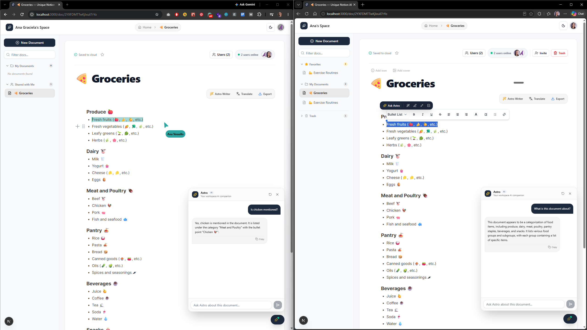
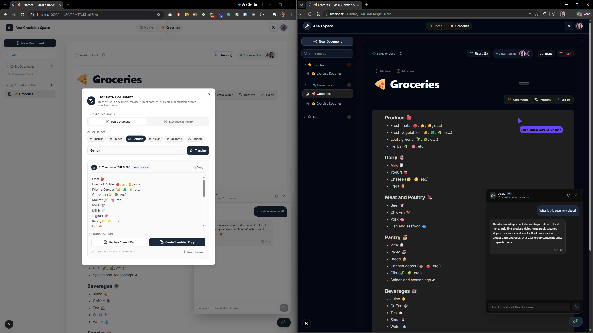

# 🪶 Unique Notion AI — Astro Workspace

<p align="center">
  <strong>A modern, real-time collaborative workspace and block-based document editor augmented with Astro AI — an edge-powered intelligence suite for live co-authoring, contextual writing assistance, multi-user presence, and instant document translation.</strong>
</p>

<p align="center">
  <a href="https://unique-notion-ai.vercel.app/"><strong>Explore the Live Application »</strong></a>
</p>

<p align="center">
  
  
  
  
  
  
  
  
  
</p>

---

## 💡 Why Unique Notion AI?

Modern knowledge management and document authoring platforms often suffer from clear architectural and workflow friction:
- **Siloed & Laggy Collaboration**: Traditional document platforms rely on heavy database polling or lockouts that create merge conflicts, sluggish cursor updates, and lost edits during team brainstorming.
- **Gimmicky, Disconnected AI**: Most AI integrations are isolated sidebars that have no context of the current document, require tedious copy-pasting, or hallucinate outside the scope of what you are writing.
- **Rigid Plain-Text Editors**: Developers and writers often face either simplistic markdown textareas or overly bloated legacy rich-text engines that corrupt nested hierarchies and block structures.
- **Costly & High-Latency AI APIs**: Relying on expensive proprietary LLM endpoints adds significant latency and API costs for standard operations like grammar correction, tone shifting, and multilingual translation.

**Unique Notion AI (Astro Workspace)** solves this by marrying three cutting-edge systems into a cohesive studio:
1. **Zero-Latency Multiplayer Sync via CRDTs**: Powered by **Liveblocks** and **Yjs**, edits merge deterministically in real time. Every collaborator sees live fluid cursors, active color badges, and instant character updates with zero merge conflicts.
2. **Modular Block-Based Canvas**: Built on **BlockNote**, the editor treats every paragraph, heading, checklist, code snippet, and callout as an independent block that can be restructured, converted, or exported to clean markdown on demand.
3. **Edge-Accelerated Astro AI Assistant**: Uses **Cloudflare Workers AI** running **Meta Llama 3.2 3B Instruct** at the edge. Intelligence happens directly where your users are with sub-second response times for full document rewriting, smart contextual text selection, real-time chat, and 20+ language translations.
4. **Role-Based Security & High-Performance Architecture**: Complete document ownership, user invites, editor revocations, and authentication handled securely across **Clerk** and **Firebase Firestore**, optimized with edge middleware and instant route prefetching.

---

## 📸 Live Interface & Feature Demos

### 1. Real-Time Multiplayer Collaboration & Grounded Astro AI Copilot



> **Key Capabilities Demonstrated Above:**
> - **Zero-Latency Multiplayer Sync**: Dual browser sessions co-editing the same document simultaneously powered by Yjs CRDTs and Liveblocks.
> - **Live Follower Cursors & Presence Badges**: Real-time cursor tracking with custom color badges (`Ana Vassallo`), live presence counters (`2 users online`), and header avatar stacks.
> - **Context-Aware Astro AI Copilot (`ChatToDocument`)**: Floating bottom-right assistant grounded in the live document tree, answering factual questions (e.g. verifying if chicken is listed under *"Meat and Poultry"*) and summarizing document contents on demand without leaving the canvas.
> - **BlockNote Canvas & Document Customization**: Notion-style modular blocks, custom emoji icons (`🍕`), and debounced real-time cloud persistence (`Saved to cloud`).

---

### 2. Intelligent Multilingual Translation & Adaptive Dark Mode



> **Key Capabilities Demonstrated Above:**
> - **Edge-Powered Document Translation**: Interactive studio modal for converting full documents or executive summaries into 20+ languages with 1-click quick-select pills.
> - **Full Hierarchy & Emoji Preservation**: The translation engine (shown converting to German) faithfully retains emoji markers, nested bullet structures, and category headers.
> - **Flexible Actions & Cloned Permissions**: Choose between **Replace Current Doc**, appending with **Insert below**, or **Create Translated Copy** (which automatically clones the cover image, emoji icon, and all collaborator permissions across Firestore).
> - **Adaptive Dark & Light Themes**: Seamless transition between dark and light modes with full contrast adherence, preserving live cursor awareness and collaborative edits across both color palettes.

---

## 🚀 Key Features

### 📝 Modular Block-Based Editor (BlockNote & Yjs)
- **Notion-Style Block Manipulation**: Write fluidly with support for headers (H1–H3), task checklists, bulleted lists, numbered lists, blockquotes, and code blocks.
- **Instant Slash (`/`) Commands**: Access formatting tools, structural changes, and insert elements with standard keyboard navigation.
- **Lossless Markdown Interoperability**: Seamlessly converts block hierarchies into Markdown and parses AI Markdown responses directly back into native editor blocks.
- **Debounced Auto-Save Engine**: Document titles and metadata are automatically synced to Firestore with visual status indicators (`Saving...` vs `Saved to cloud`).
- **Dynamic Browser Tab Title Sync**: Intelligently updates browser tab titles (`[Document Name] — Unique Notion AI`) in real time as documents are created, loaded, or renamed.

### 🎨 Document Covers & Page Emojis
- **Designer Gradients & Custom Imagery**: Choose from 8 curated designer gradient banners (*Cosmic Indigo, Sunset Horizon, Ocean Depth, Emerald Glade, Obsidian Night, Golden Amber, Pastel Lavender, Cyberpunk Neon*) or paste any custom image link (Unsplash, etc.).
- **Interactive Emoji Picker**: Select from popular Notion emojis (💡, 🚀, 🪐, 🎯, 📚, 🎨, 💼, 🔬, ⚡, 🔥, 💻, 🧠, 🌿, ✨, ☕, 🌟, 📌) or enter any custom emoji from your keyboard.
- **Dynamic Sidebar Icon Sync**: Setting a document icon automatically replaces the default gray file icon in your sidebar with your custom emoji for instant visual recognition.

### 📄 Multi-Format Export Hub (Markdown & Clean PDF)
- **One-Click Markdown (.md) Export**: Instantly download your document as a clean, standardized Markdown file compatible with GitHub, Obsidian, Notion, and any note-taking app.
- **Publication-Ready PDF Export**: Export your document as a pristine, print-ready PDF with dedicated layout rules that automatically:
  - Remove all UI distractions (sidebars, toolbars, action buttons, floating chat widgets, and watermark badges).
  - Eliminate browser headers and footers (no page URLs, timestamps, or app titles on the printed page).
  - Apply balanced, elegant document margins (`16mm × 20mm`) for crisp reading and printing.

### ⭐ Starred / Favorite Documents
- **User-Specific Favoriting**: Pin important documents with the Star toggle button in the document toolbar. Favoriting is stored per user, ensuring personal customization without affecting teammates' sidebars.
- **Dedicated Favorites Section**: Favorited documents are automatically elevated into a collapsible **Favorites** section at the very top of the sidebar with a gold star badge and live document counter.

### 🗑️ Trash & Archive Bin (Safe Deletion & Restore)
- **Two-Stage Safe Deletion**: Eliminates accidental data loss by replacing immediate deletion with a safe **Move to Trash** workflow.
- **Collapsible Trash Drawer**: View and manage trashed files in a dedicated **Trash** section at the bottom of the sidebar.
- **In-Document Safety Banner**: Opening a trashed document activates read-only mode and displays an interactive warning banner with one-click **Restore** or **Delete Permanently** options.

### 👥 Real-Time Multiplayer Collaboration & Presence
- **Live Cursors & Follow Pointers**: See other active collaborators moving around the page in real time with individualized color-coded labels and cursor arrows.
- **Presence Avatars & Live Status**: Top header avatar stack displaying who is actively viewing or editing the document, complete with live ping indicators and tooltips.
- **Deterministic CRDT Synchronization**: Yjs XML fragments handle simultaneous edits across tabs and team members without overwriting or race conditions.
- **Secure Token-Based Authorization**: Liveblocks sessions are authorized through a dedicated serverless route (`/app/auth-endpoint`) verifying room membership.

### 🪄 Astro Writing Assistant (Studio Modal)
- **Full-Document & Selection Scopes**: Switch between improving your entire workspace document or honing in on a specific block selection.
- **Smart Cursor Auto-Capture**: Highlighting text in the editor before clicking **Astro Writer** automatically pre-fills the selection tab for instant workflow continuation.
- **Transformative AI Presets**:
  - 🪄 **Improve Writing**: Elevates flow, vocabulary, readability, and structural rhythm without dropping sections.
  - ✏️ **Fix Grammar**: Eliminates spelling, typographical, and grammatical errors while retaining the author's voice.
  - 🗜️ **Make Concise**: Trims wordiness and redundant filler for punchy, impactful communication.
  - ☑️ **Action Items**: Analyzes unstructured notes and outputs clean Markdown task checklists (`- [ ]`).
  - 💼 **Professional Tone**: Rewrites content for executive stakeholders, clients, or corporate reports.
  - 💬 **Casual Tone**: Converts rigid text into an approachable, friendly conversational tone.
  - ⚡ **Continue Writing**: Extends outlines and brainstorms with structured reasoning and detail.
  - 📄 **Executive Summary**: Generates high-level summaries with bulleted takeaways.
  - 🎯 **Custom Instruction**: Freeform prompt bar to execute arbitrary transformations.
- **Instant Actions**: One-click **Copy to Clipboard**, **Insert Below**, or complete **Replace Document**.

### ⚡ Floating Contextual Selection Toolbar
- **Interactive Inline HUD**: Highlighting any phrase in the editor immediately surfaces an intelligent floating toolbar positioned directly above or below the cursor.
- **Rapid Actions**: One-tap quick buttons for *Fix*, *Improve*, *Shorten*, *Expand*, and custom queries.
- **Inline Markdown Preview**: Review generated improvements in place with one-click **Replace Selection** or **Insert Below**.

### 💬 Interactive Q&A (Chat to Document)
- **Floating Document Copilot**: Bottom-right assistant widget allowing users to ask natural-language questions about the document content.
- **Grounded Context**: The edge microservice ingests the clean document tree to answer questions, explain concepts, or find details buried in large notes.

### 🌐 Multi-Language Document Translation & Permission-Preserved Cloning
- **20+ Languages Supported**: Translate documents instantly into Spanish, French, German, Italian, Japanese, Chinese, Russian, Portuguese, Dutch, Swedish, Norwegian, Finnish, Danish, Polish, Turkish, Arabic, Hebrew, Hindi, and more.
- **Dual Translation Scopes**:
  - **Full Document**: Translates every section, heading, checklist, and detail while preserving block structure and formatting.
  - **Executive Summary**: Generates a high-level translated digest of complex notes.
- **In-Place Document Replacement**: Instantly swap the current document's contents with the translated version directly in the collaborative BlockNote editor (`editor.replaceBlocks`).
- **Permission-Preserved Cloned Copies**: Create a new standalone document titled `[Doc Name] ([Language])`, inheriting original cover images and emoji icons, while **automatically copying all existing collaborator permissions** (`owner` and `editor` roles) across Firestore so team members retain immediate access.
- **Insert Below**: Append translated blocks directly underneath existing text for bilingual notes and references.

---

## 🛠️ Complete Tools & Technologies (Why Each Was Used)

This application was intentionally built with a best-in-class modern stack where every library, platform, and framework serves a specific purpose:

### 1. Frontend Framework & Architecture
- **[Next.js 15 (App Router & Turbopack)](https://nextjs.org/)**:
  - *Why it was used*: Provides the foundational hybrid architecture. We leverage **Server Components** for fast initial rendering, **Server Actions** (`actions/actions.ts`) for zero-API boilerplate database mutations, **Route Handlers** for edge token authentication, and **Turbopack** for instant local HMR.
- **[React 19](https://react.dev/)**:
  - *Why it was used*: Powers the reactive UI using modern concurrent primitives like `useTransition` for smooth non-blocking AI state updates and `useOptimistic` for instant feedback.
- **[TypeScript 5](https://www.typescriptlang.org/)**:
  - *Why it was used*: Guarantees end-to-end type safety across Liveblocks presence storage, Firestore document schemas, Clerk session claims, and BlockNote block schemas.

### 2. Styling & Design System
- **[Tailwind CSS v4](https://tailwindcss.com/)**:
  - *Why it was used*: Modern utility-first styling engine with sub-millisecond build times, allowing rapid creation of responsive sidebars, floating toolbars, and rich glassmorphism.
- **[shadcn/ui](https://ui.shadcn.com/) & [Radix UI Primitives](https://www.radix-ui.com/)**:
  - *Why it was used*: Provides headless, accessible, keyboard-navigable components (`Dialog`, `Sheet`, `Tooltip`, `Select`, `Button`, `Input`, `Avatar`). It gives complete aesthetic control without being locked into heavyweight component frameworks.
- **[Next Themes](https://github.com/pacocoursey/next-themes)**:
  - *Why it was used*: Delivers flawless dark/light mode switching with automatic system preference detection, zero flash of unstyled content (FOUC), and synchronization with BlockNote themes.
- **[Lucide React](https://lucide.dev/)**:
  - *Why it was used*: Provides lightweight, consistent vector iconography across the studio (e.g., Feather, Wand2, Star, Trash2, Download, Printer, Image, Smile, Sparkles, Zap).
- **[Sonner](https://sonner.emilkowal.ski/)**:
  - *Why it was used*: Ultra-clean, performant toast notification system for copying to clipboard, notifying users of document updates, and alerting on network status.

### 3. Real-Time Collaborative Canvas
- **[BlockNote](https://www.blocknotejs.org/) (`@blocknote/core`, `@blocknote/react`, `@blocknote/shadcn`)**:
  - *Why it was used*: A modern block-based editor built on top of ProseMirror. Unlike raw contenteditable textareas, BlockNote treats elements as modular blocks with clean JSON/Markdown export/import capabilities, drag-and-drop handles, and native collaboration hooks.
- **[Yjs](https://github.com/yjs/yjs)**:
  - *Why it was used*: The industry standard Conflict-Free Replicated Data Type (CRDT) framework for collaborative editing. It models document mutations as mathematical CRDT operations so concurrent offline/online edits merge deterministically without data loss.
- **[Liveblocks](https://liveblocks.io/) (`@liveblocks/client`, `@liveblocks/react`, `@liveblocks/yjs`, `@liveblocks/node`)**:
  - *Why it was used*: Powers the real-time collaboration infrastructure. It binds directly to the Yjs provider, coordinates live cursor presence, broadcasts active user awareness, manages session tokens, and eliminates the need to run and maintain custom WebSocket servers.

### 4. Authentication & Security
- **[Clerk](https://clerk.com/) (`@clerk/nextjs`)**:
  - *Why it was used*: Complete identity management providing seamless user sign-up, sign-in, social logins, user avatars, profile popups (`UserButton`), session claims, and secure server-side route guards (`auth.protect()`).

### 5. Database & Document Persistence
- **[Firebase Firestore & Admin SDK](https://firebase.google.com/) (`firebase`, `firebase-admin`, `react-firebase-hooks`)**:
  - *Why it was used*:
    - **Firestore Client SDK & Hooks**: Enables real-time listeners (`useCollection`, `useDocumentData`) for reactive document lists and instant title synchronization across tabs.
    - **Firebase Admin SDK**: Executes protected server-side operations (creating documents, cascading room deletions, user invite indexing) in Next.js Server Actions with full administrative security.
    - **Environment-based Service Key**: Dynamically switches between local `service_key.json` and production `FIREBASE_SERVICE_KEY` environment variables.

### 6. Edge AI Microservice Backend
- **[Cloudflare Workers](https://workers.cloudflare.com/)**:
  - *Why it was used*: Serverless execution at Cloudflare's global edge network (over 300+ data centers), providing global sub-millisecond routing to AI models without cold-start latency.
- **[Hono](https://hono.dev/)**:
  - *Why it was used*: An ultrafast, lightweight web framework designed specifically for Cloudflare Workers. It handles request validation, CORS headers, and route dispatching with negligible memory footprint.
- **[Cloudflare Workers AI](https://developers.cloudflare.com/workers-ai/) (`@cf/meta/llama-3.2-3b-instruct`)**:
  - *Why it was used*: Directly invokes Meta's cutting-edge Llama 3.2 3B Instruct model running serverless on edge GPUs. It delivers rapid text transformations, grammar fixes, task extractions, and translations with zero external API fees or third-party rate limits.

### 7. Deployment & DevOps
- **[Vercel](https://vercel.com/)**:
  - *Why it was used*: Continuous deployment pipeline that automatically builds and deploys production Next.js assets on every Git push to `master`.
- **[Wrangler CLI](https://developers.cloudflare.com/workers/wrangler/)**:
  - *Why it was used*: Manages bundling, previewing, and deployment of the Cloudflare Workers backend.

---

## 🏗️ How it Works Under the Hood

```
┌─────────────────────────────────────────────────────────────────────────────────┐
│                           Client Browser (Next.js 15)                           │
│                                                                                 │
│   ┌─────────────────┐       ┌────────────────────┐       ┌──────────────────┐   │
│   │   Clerk Auth    │       │  BlockNote Editor  │       │ Astro AI Toolbar │   │
│   │  Session Claims │       │  (ProseMirror UI)  │       │ & Modal Assistant│   │
│   └────────┬────────┘       └─────────┬──────────┘       └────────┬─────────┘   │
└────────────┼──────────────────────────┼───────────────────────────┼─────────────┘
             │                          │                           │
             ▼                          ▼                           ▼
┌────────────────────────┐  ┌───────────────────────┐  ┌──────────────────────────┐
│   Firebase Firestore   │  │  Liveblocks WebSocket │  │  Cloudflare Edge Worker  │
│                        │  │                       │  │   (Hono Framework)       │
│  - Documents Metadata  │  │  - Realtime Sync (Yjs)│  │                          │
│  - Covers & Icons      │  │  - Live Cursors       │  │  - Prompt Synthesis      │
│  - Favorites & Trash   │  │  - Collaborator State │  │  - Document Cleaner      │
└────────────┬───────────┘  └───────────────────────┘  └────────────┬─────────────┘
             │                                                      │
             ▼                                                      ▼
┌────────────────────────┐                             ┌──────────────────────────┐
│ Next.js Server Actions │                             │   Cloudflare Workers AI  │
│ (Firebase Admin SDK)   │                             │  @cf/meta/llama-3.2-3b   │
│ - Cloned Permissions   │                             │  - Edge GPU Inference    │
└────────────────────────┘                             └──────────────────────────┘
```

### 🤖 The Astro AI & Chatbot Engine (How It Works)

Astro AI is an edge-first intelligence system that is deeply integrated into the collaborative canvas rather than acting as a detached third-party chatbot:

#### 1. In-Context Grounding & Document Cleaner (`extractCleanText`)
When you chat with a document or ask Astro to transform it, the client extracts the live collaborative state from Yjs (`doc.get('document-store').toJSON()`). Before passing this data to the LLM, the edge worker executes a custom AST text extractor:
- Strips ProseMirror and BlockNote internal XML container tags (`<blockcontainer>`, `<heading>`, `<paragraph>`, etc.).
- Normalizes escaped entities (`&nbsp;`, `&amp;`, `&quot;`) and cleans whitespace.
- Preserves natural paragraph and section line breaks so the LLM receives clean, readable Markdown context without prompt contamination or wasted token budget.

#### 2. Grounded Chatbot Copilot (`ChatToDocument.tsx`)
- Positioned as a floating widget in the lower-right corner.
- Injects the active document context into the system prompt:
  > *"You are a helpful assistant helping the user chat with and ask questions about a document. Answer the user's questions clearly, accurately, and concisely using Markdown formatting based on the following document content..."*
- Enables conversational Q&A, brainstorming, fact retrieval, and summarizing without leaving the editor.

#### 3. Astro Writing Assistant (`AstroWritingAssistant.tsx`)
- Detects whether you have highlighted text with your cursor or want to transform the whole document.
- Provides 1-click presets (*Improve Writing, Fix Grammar & Spelling, Make Concise, Extract Action Items, Shift Tone, Executive Summary*).
- Allows you to preview the generated Markdown, copy it to clipboard, or apply it directly to the editor using `editor.replaceBlocks(editor.document, blocks)`.

#### 4. Contextual Selection HUD (`AstroSelectionToolbar.tsx`)
- Listens to DOM selection events inside the editor canvas.
- Floats directly above the cursor when text is selected.
- Allows immediate inline grammar repairs and tone enhancements that replace only the selected range.

#### 5. Multilingual Translation & Permission-Preserved Clones (`TranslateDocument.tsx`)
- Translates full documents or executive summaries into 20+ languages.
- Provides 1-click **In-Place Replacement** or creates a **Translated Copy** (`actions.ts -> createTranslatedCopy`).
- The cloning engine duplicates the source document's cover image and emoji icon, and queries Firestore (`collectionGroup("rooms")`) to **replicate all existing user permissions (`owner` and `editor`)** across every collaborator so team access remains seamless.

---

## 💻 Tech Stack Summary

| Technology | Purpose & Implementation |
| :--- | :--- |
| **[Next.js 15.5](https://nextjs.org/)** | App Router, Server Actions, Server Components, and API Route handlers |
| **[React 19](https://react.dev/)** | Modern concurrent UI architecture and state hooks (`useTransition`) |
| **[TypeScript 5](https://www.typescriptlang.org/)** | Strict type definitions across schemas, models, and real-time rooms |
| **[BlockNote](https://www.blocknotejs.org/)** | Modular block-based document editor with slash menu and Markdown support |
| **[Liveblocks](https://liveblocks.io/)** | Real-time presence, multiplayer cursors, and room permissions infrastructure |
| **[Yjs CRDT](https://github.com/yjs/yjs)** | High-performance conflict-free data synchronization engine |
| **[Cloudflare Workers](https://workers.cloudflare.com/)** | Edge serverless runtime executing backend AI microservices |
| **[Hono Framework](https://hono.dev/)** | High-performance edge routing with CORS and structured endpoints |
| **[Cloudflare Workers AI](https://developers.cloudflare.com/workers-ai/)** | Running `@cf/meta/llama-3.2-3b-instruct` on edge GPUs |
| **[Firebase Firestore](https://firebase.google.com/)** | Document metadata, rooms index, and real-time collection streams |
| **[Firebase Admin SDK](https://firebase.google.com/)** | Server-side document creation, cascading room deletions, and user authorization |
| **[Clerk](https://clerk.com/)** | Authentication, secure session tokens, user profiles, and route protection |
| **[Tailwind CSS v4](https://tailwindcss.com/)** | Responsive utility styling, dark/light theme variables, and glassmorphic HUDs |
| **[shadcn/ui](https://ui.shadcn.com/)** | Headless accessible UI primitives built with Radix UI |
| **[Next Themes](https://github.com/pacocoursey/next-themes)** | System-aware dark and light theme switching |
| **[Lucide React](https://lucide.dev/)** | Vector icon system across buttons, actions, and headers |
| **[Vercel](https://vercel.com/)** | Production CI/CD hosting with automated Git-triggered deployments |

---

## 🎬 Step-by-Step User Guide

Using **Unique Notion AI** is simple and fluid:

1. **Sign In & Access Your Space**:
   - Navigate to the app and sign in via Clerk (Google, GitHub, or Email).
   - Your personalized workspace header displays your profile, avatar, and quick links with the branded feather badge.
2. **Create or Open a Document**:
   - In the sidebar (or directly from the welcome screen), click **New Document** to generate a collaborative page.
   - Edit the document title inline; the system auto-saves changes to Firestore with debounce protection.
3. **Personalize with Covers & Emojis**:
   - Hover above the document title and click **`+ Add icon`** to pick an emoji (or type your own). The icon immediately syncs with your sidebar list!
   - Click **`+ Add cover`** to choose one of 8 designer gradient banners or paste a custom image URL.
4. **Organize with Favorites & Trash**:
   - Click the **Star** icon in the document toolbar to add notes to your **Favorites** sidebar folder.
   - Click **Trash** to safely soft-delete a document. Restore it at any time from the **Trash** section in the sidebar.
5. **Write with Modular Blocks**:
   - Type `/` to open the slash menu and insert headers, bullet points, checklists, or code blocks.
   - Format text inline using standard bold, italics, links, and highlights.
6. **Collaborate in Real Time**:
   - Click **Invite** in the document header to grant editing permissions to a teammate by email.
   - When teammates join, their live cursors and name badges appear on your screen in real time.
7. **Supercharge Writing with Astro AI**:
   - **Contextual Selection Toolbar**: Highlight any text on the page. The floating HUD pops up immediately with instant options to improve, fix grammar, or shorten.
   - **Astro Writer Modal**: Click the **Astro Writer** button in the top toolbar to transform the entire document or pre-selected text with presets like *Action Items*, *Professional Tone*, or *Make Concise*.
   - **Chat to Document**: Click the bottom-right chat bubble to converse with your document notes in natural language.
   - **Translate**: Click **Translate** in the header toolbar to convert notes into 20+ languages.
8. **Export Your Work**:
   - Click **Export** in the top toolbar to instantly download your notes as clean **Markdown (.md)** or export to **PDF**.

---

## 📁 Project Structure

```text
unique-notion-ai/
├── actions/
│   └── actions.ts                # Server Actions (Create, Delete, Trash, Restore, Favorite, Invite)
├── app/
│   ├── auth-endpoint/            # Liveblocks session token authorization endpoint
│   ├── doc/
│   │   ├── [Id]/
│   │   │   ├── layout.tsx        # RoomProvider wrapper
│   │   │   ├── loading.tsx       # Instant zero-CLS document skeleton
│   │   │   └── page.tsx          # Dynamic document route
│   │   └── layout.tsx            # LiveBlocksProvider global wrapper
│   ├── globals.css               # Tailwind CSS v4 directives & @media print rules
│   ├── layout.tsx                # Root shell, ClerkProvider, ThemeProvider, Metadata
│   └── page.tsx                  # Branded welcome view with instant New Document CTA
├── backend/                      # Cloudflare Workers edge AI microservice
│   ├── src/
│   │   └── index.ts              # Hono server handling chat, translation & writing AI
│   └── wrangler.jsonc            # Cloudflare Worker configuration & AI bindings
├── components/
│   ├── AstroSelectionToolbar.tsx # Floating contextual AI toolbar for text selection
│   ├── AstroWritingAssistant.tsx # Studio modal for full-document transformations
│   ├── Avatars.tsx               # Active collaborators presence avatar stack
│   ├── Breadcrumbs.tsx           # Hierarchical document navigation bar
│   ├── ChatToDocument.tsx        # Floating natural language Q&A copilot widget
│   ├── DarkModeToggle.tsx        # Theme toggle button (Light/Dark mode)
│   ├── DeleteDocument.tsx        # Safe Move to Trash & Permanent Deletion modal
│   ├── Document.tsx              # Document coordinator, title debouncer & trash banner
│   ├── DocumentHeaderCustomizer.tsx # Notion cover banners (8 gradients/URL) & emoji picker
│   ├── Editor.tsx                # BlockNote + Liveblocks + Yjs canvas integration
│   ├── ExportDocument.tsx        # One-click export to Markdown (.md) and PDF
│   ├── FollowPointer.tsx         # Live collaborator cursor pointer & name badge
│   ├── Header.tsx                # Feather-branded header, user button & breadcrumbs
│   ├── InviteUser.tsx            # Collaborator invitation dialog
│   ├── LiveBlocksProvider.tsx    # Top-level Liveblocks client provider
│   ├── LiveCursorProvider.tsx    # Multiplayer pointer broadcast coordinator
│   ├── ManageUsers.tsx           # Document editor permissions management modal
│   ├── NewDocumentButton.tsx     # Sidebar action trigger to spawn documents
│   ├── RoomProvider.tsx          # Room wrapper injecting Yjs collaborative state & skeleton
│   ├── Sidebar.tsx               # Sidebar with Search, Favorites, My Docs & Trash
│   ├── SidebarOption.tsx         # Sidebar item with custom emoji sync & route prefetching
│   ├── ThemeProvider.tsx         # Next-Themes provider wrapper
│   ├── TranslateDocument.tsx     # Multi-language translation dialog
│   └── ui/                       # shadcn/ui accessible Radix primitives
├── firebase.ts                   # Client-side Firebase Firestore initialization
├── firebase-admin.ts             # Server-side Firebase Admin SDK initialization
├── liveblocks.config.ts          # Liveblocks room and presence types
├── middleware.ts                 # Edge route matcher protecting /doc without server latency
├── next.config.ts                # Next.js optimizations & serverExternalPackages
└── package.json                  # Project dependencies and script definitions
```

---

## 🌐 Deployment

### Frontend (Vercel)
The Next.js frontend is deployed on **[Vercel](https://vercel.com/)**. Every commit pushed to the `master` branch triggers an automated zero-downtime production deployment.
👉 **Live URL**: [https://unique-notion-ai.vercel.app/](https://unique-notion-ai.vercel.app/)

### Backend AI Microservice (Cloudflare Workers)
The backend AI microservice is deployed serverless on **[Cloudflare Workers](https://workers.cloudflare.com/)** with global edge GPU bindings running Meta Llama 3.2 3B Instruct, providing ultra-low-latency edge inference for writing transformations, chat Q&A, and translations.

---

## 👩‍💻 Author & Credits

Designed, architected, and maintained with passion by:

**Ana Graciela Vassallo Fedotkin**  
- 🌐 **Live Website**: [https://unique-notion-ai.vercel.app/](https://unique-notion-ai.vercel.app/)  
- 🐙 **GitHub**: [@AnaGVF](https://github.com/AnaGVF)  
- 📁 **Repository**: [unique-notion-ai](https://github.com/AnaGVF/unique-notion-ai)

---

## 📄 License & Intellectual Property

*Copyright © 2026 Ana Graciela Vassallo Fedotkin. All rights reserved.*

Crafted with dedication as a modern exploration of real-time collaborative editing and agentic AI.
